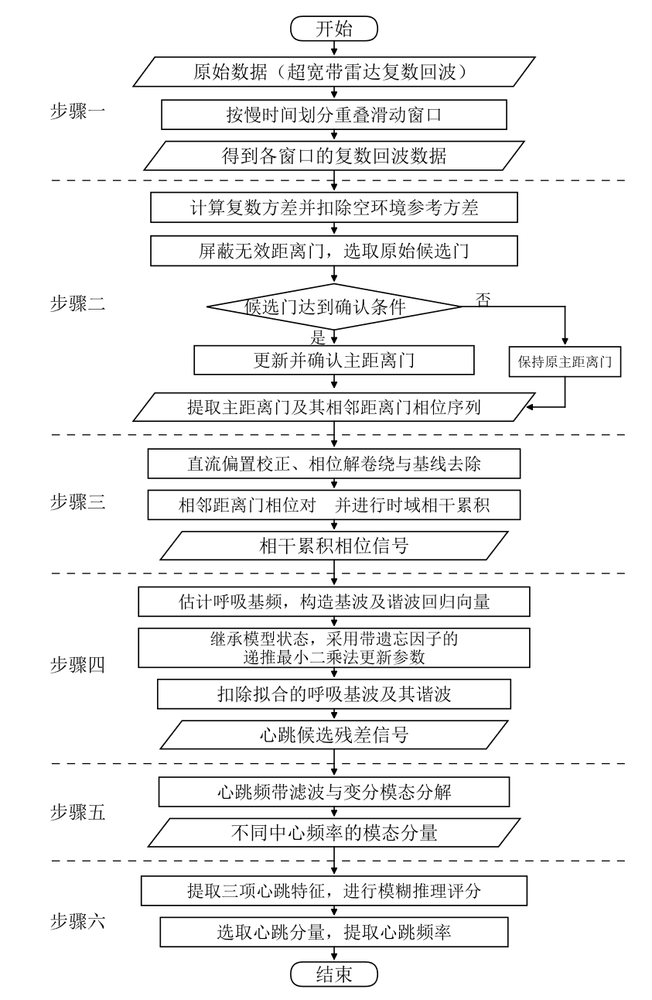

# UWB-Heartbeat-Toolbox

**基于超宽带（UWB）雷达的呼吸与心跳信号分析工具箱**  
*A lightweight Python toolbox for UWB radar-based respiration and heartbeat analysis.*

本项目面向 **NCJ29D6 雷达 CIR 数据的离线处理**。项目拆分为可复用的 Python 模块，并提供参数配置、简单运行示例和结果可视化，方便其他研究者理解和调用算法。

## 1. 算法流程 / Method



**实际代码处理步骤：**

1. **CIR 数据读取**：解析雷达 JSON，恢复逐帧 I/Q 复数回波，并读取可选空场参考。
2. **滑动窗口与目标跟踪**：对各距离门进行动态响应评分，结合历史选择结果确定主距离门。
3. **相位预处理**：提取主距离门相位，完成解卷绕、去趋势和带通滤波。
4. **呼吸提取与谐波抑制**：估计呼吸频率，利用最小二乘拟合呼吸谐波并从相位信号中扣除。
5. **心跳分量提取**：进行心跳频带滤波、VMD 分解，利用模糊推理对 IMF 分量评分并提取心率。
6. **滑窗结果与 OLA 重建**：输出逐窗口频率估计，并对窗口信号执行重叠相加重建。

详细说明见 [算法文档](docs/METHOD.md)。

## 2. 项目结构 / Repository Structure

```text
UWB-Heartbeat-Toolbox/
├── README.md
├── pyproject.toml
├── .gitignore
├── .gitattributes
├── CITATION.cff
├── src/uwb_heartbeat_toolbox/  # 雷达数据读取、预处理、跟踪、LS/RLS、VMD、模糊推理及主流程
├── configs/
│   └── default.json           # 示例程序读取的算法参数
├── examples/
│   └── run_and_export.py      # 可在 VSCode 中直接运行的示例
├── docs/
│   ├── METHOD.md              # 算法流程
│   ├── PARAMETERS.md          # 参数说明
│   └── DATA_FORMAT.md         # 数据格式说明
├── assets/
│   └── pipeline.svg           # 算法流程图
├── data/
│   ├── README.md
│   └── sample/                # 经过授权后公开的示例 JSON（见下文）
└── tests/                     # 基础单元测试
```

## 3. 环境安装 / Installation

**建议环境：** Python 3.9（原始开发环境为 Python 3.9.7），NumPy、SciPy、Matplotlib。依赖范围由 `pyproject.toml` 管理。

在项目根目录打开终端，推荐使用独立 Conda 环境：

```bash
conda create -n uwb_opensource python=3.9.7 -y
conda activate uwb_opensource
python -m pip install -e .
```

其中 `-e .` 是可编辑安装：安装后，修改项目 `src/` 中的 Python 源码，下一次运行即可使用更新后的代码，通常不需要重新安装。

## 4. 示例数据 / Example Data

项目使用雷达采集的 JSON 文件，建议提供一对可公开的示例数据：

```text
data/sample/
├── measurement.json  # 有人场景测量数据
└── background.json   # 同一采集条件下的空场参考数据
```

数据字段、CIR I/Q 解码和采样率计算方式详见 [数据格式说明](docs/DATA_FORMAT.md)。

## 5. 快速开始 / Quick Start

### 方式 A：在 VSCode 中直接运行（推荐）

1. 使用 VSCode 打开项目根目录，选择安装了本工具箱的 Python 解释器。
2. 打开 `examples/run_and_export.py`，将其中的数据路径、配置文件路径及输出目录设为：

   ```python
   input_file = "data/sample/measurement.json"
   empty_file = "data/sample/background.json"
   config_file = "configs/default.json"
   output_dir = "runs/case01"
   ```

   如果数据文件放在其他位置，改为实际路径即可；没有空场文件时可将 `empty_file` 设为 `None`。
3. 在 VSCode 右上角点击 **Run Python File** 运行。相对路径默认以**项目根目录**为当前工作目录。

程序使用 `configs/default.json` 中的参数，调用 `BreatheAndHeartSlidingWindowed` 运行原始算法，并保存逐窗口结果与两张图像。

### 方式 B：命令行运行（可选）

```bash
python -m uwb_heartbeat_toolbox --filename "data/sample/measurement.json" --empty "data/sample/background.json"
```

查看命令行可调选项：

```bash
python -m uwb_heartbeat_toolbox --help
```

**注意：** 命令行入口使用 `cli.py` 中的命令行参数与默认值，**不会自动读取** `configs/default.json`；该 JSON 由方式 A 的示例程序读取。

## 6. 运行结果 / Outputs

示例 `run_and_export.py` 仅保存以下三个结果文件：

| 输出文件 | 内容 |
| --- | --- |
| `window_metrics.csv` | 每个滑动窗口的时间、目标距离门、呼吸频率、心跳频率、IMF 选择和状态等信息；其中 `resp_freq`、`heart_freq` 的单位为 **Hz** |
| `03_rate_curves.png` | 逐窗口呼吸率和心率曲线，单位为 **BPM**（1 Hz = 60 BPM） |
| `04_ola_reconstruction.png` | OLA 重建的呼吸和心跳时域波形 |

**提示：** 无效或未检测到的窗口可能以零频率输出，不能将其解释为真实的生理心率或呼吸率。结果文件默认保存在 `runs/`。

## 7. 参数配置 / Configuration

修改 `configs/default.json`，即可调整示例程序的主要参数，无需修改算法源码。

| 参数 | 默认值 | 含义 |
| --- | ---: | --- |
| `range_min_m` / `range_max_m` | `0.3` / `7.65` | 目标搜索距离范围，单位 m |
| `window_sec` | `20.0` | 滑动窗口长度，单位 s |
| `hop_sec` | `1.0` | 滑动步长，单位 s |
| `detection_threshold` | `2000.0` | 目标距离门动态响应评分阈值 |
| `complex_var_threshold` | `null` | 复数方差评分门限；`null` 表示采用检测阈值 |
| `resp_null_amplitude` | `0.1` | 呼吸无效能量判定的参考正弦幅值 |
| `heart_null_amplitude` | `0.01` | 心跳无效能量判定的参考正弦幅值 |
| `vmd_k` | `5` | VMD 分解模态数 |
| `vmd_alpha` | `1000.0` | VMD 带宽惩罚参数 |
| `plot_every` | `1` | 内部绘图更新的窗口间隔 |

完整参数说明和调整建议见 [PARAMETERS.md](docs/PARAMETERS.md)。

## 8. 基础测试 / Tests

本项目保留两项简洁的单元测试：雷达 JSON/IQ 解码，以及 FFT 已知频率识别。

```bash
python -m unittest discover -s tests -v
```

这些测试只验证基础模块，不代表对完整算法精度的评估；完整效果应结合真实雷达数据和参考测量值判断。

## 9. 研究来源、引用与许可 / Citation & License

- **研究背景：** 基于本人的本科毕业设计。
- **方法关联：** 与“动态环境下基于超宽带雷达的心跳检测方法”相关的专利研究。
- **第三方代码：** `src/uwb_heartbeat_toolbox/vmdpy.py` 使用 Vinícius Rezende Carvalho 的 VMD Python 实现；保留其原有版权与 [MIT 许可证文件](src/uwb_heartbeat_toolbox/LICENSE-vmdpy.txt)。
- **软件引用：** 仓库提供 [`CITATION.cff`](CITATION.cff)，正式发布前请核对作者、版本及仓库地址。
- **项目许可：** 本项目自有代码不允许在未经过作者同意的情况下私自使用或者用于学习或者商业用途。

> **免责声明：** 本项目用于课程大作业要求，不是经过临床验证的医疗监护设备，不应用于医疗诊断或安全关键决策。
